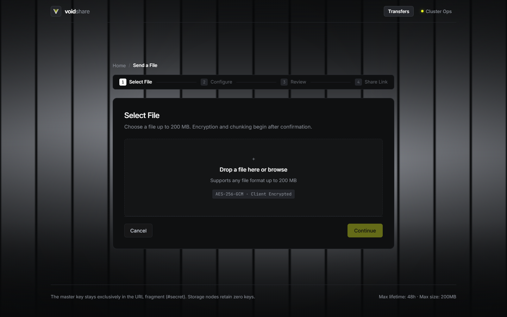

# VoidShare

<div align="center">

```
  _  _       _      _  ___  _                       
 | || | ___ (_)  __| |/ __|| |_   __ _  _ _  ___    
 | || |/ _ \| | / _` |\__ \| ' \ / _` || '_|/ -_)   
  \_/  \___/|_| \__,_||___/|_||_|\__,_||_|  \___|   
```

**Peer-Replicated, Zero-Knowledge Distributed File Storage with Transparent Read Failover, Consistent Hashing, and Autonomous Health Telemetry.**

[](LICENSE)
[](#2-run-test-suite)
[](https://www.typescriptlang.org/)
[](https://fastify.dev/)
[](https://react.dev/)
[](https://vitejs.dev/)
[](docs/SECURITY.md)
[](docs/DISTRIBUTED_SYSTEMS.md)

</div>

---

## 📸 Application Showcase

### 1. Real-Time Cluster Operations Console (`/cluster`)
Live topology health monitoring, storage capacity telemetry, per-chunk replica distribution, and cluster event timeline.


### 2. Client-Side Encrypted File Ingestion
Sleek glassmorphism upload wizard with in-browser WebCrypto AES-256-GCM chunking, download quotas (1 to 100), and auto-expiration (1h to 48h).


### 3. Capability-Based Code Retrieval
Dual access modes: recipients can retrieve transfers using direct share links or unpadded 43-character URL-safe Base64 retrieval codes with pre-flight metadata preview.


### 4. Minimalist Dark Landing Interface
Intuitive split-intent entry mode with real-time cluster status banner and zero-knowledge privacy guarantees.


---

## ⚡ Key Features

- **🔒 Client-Side Zero-Knowledge Encryption:** Files are partitioned into 4MiB blocks and encrypted client-side using AES-256-GCM with fresh 12-byte random IVs per chunk. The master secret stays exclusively in the client's URL fragment (`#secret`) or 43-character retrieval code (`vs1-...`); the coordinator and storage nodes never receive or store the encryption key.
- **🔄 Consistent Ring Placement & Confirmed Dual Writes ($RF=2$):** Chunks are mapped across storage nodes using a consistent hash ring with virtual nodes. The coordinator enforces strict ingestion consistency: writes must be confirmed by **both** storage nodes before marking a chunk `STORED` and presenting the transfer as `READY`.
- **💓 Autonomous Failure Detection:** Storage daemons emit periodic authenticated heartbeats (every 3000ms). The coordinator's autonomous `HealthMonitor` loop continuously audits nodes:
  - `HEALTHY`: Heartbeat age $\le 5000\text{ms}$.
  - `UNHEALTHY`: Heartbeat age between $5000\text{ms}$ and $10000\text{ms}$.
  - `UNAVAILABLE`: Heartbeat age $> 10000\text{ms}$.
- **🛡️ Transparent Replica Read Failover:** If a primary storage node crashes or network partition occurs mid-download, `ReplicaReadService` catches the connection refusal and automatically fails over to the surviving replica node. Recipients experience uninterrupted, non-corrupted file streaming.
- **🔑 Dual Access Capabilities (Links & Codes):** Senders receive both direct URLs and 43-character URL-safe Base64 capability codes. Recipients can preview file size, MIME type, and expiration before initiating downloads without consuming quota.
- **🧹 Automated Expiration & Orphan Resilience:** Background workers enforce download limits and TTL expiration. When nodes are offline during a deletion sweep, lingering chunks are marked `ORPHANED_PENDING_DELETE` and purged automatically once the node recovers.
- **📊 Real-Time Observability:** Dedicated `/cluster` dashboard displays active nodes, disk capacity utilization, per-chunk replica placement, and a persisted SQLite event stream (`cluster_events`).

---

## 🏗️ System Architecture

```mermaid
flowchart TD
    subgraph Client["Sender & Receiver Browsers"]
        UI["React 19 + Vite UI"]
        Crypto["WebCrypto AES-256-GCM<br/>(4MB Chunks + Random IV)"]
        Code["43-Char Retrieval Code<br/>(Capability Hash)"]
    end

    subgraph Coordinator["Coordinator Service (:8080)"]
        API["Fastify API Server"]
        DB[(SQLite Metadata<br/>Ring + Replicas + Events)]
        Ring["Consistent Hash Ring (RF=2)"]
        Health["Autonomous HealthMonitor"]
        Failover["ReplicaReadService"]
        Sweeper["ExpirationSweeper & Reconciler"]
    end

    subgraph StorageNodes["Independent Storage Daemons (:9001, :9002)"]
        Node1["Storage Node 1<br/>- Encrypted Chunks<br/>- Heartbeat Emitter"]
        Node2["Storage Node 2<br/>- Encrypted Chunks<br/>- Heartbeat Emitter"]
    end

    UI -->|1. Encrypt Chunks Locally| Crypto
    Crypto -->|2. POST /api/transfers| API
    API -->|3. Consistent Hashing| Ring
    API -->|4. Replicate Chunk (Bearer Auth)| Node1
    API -->|4. Replicate Chunk (Bearer Auth)| Node2
    Node1 -.->|Heartbeats (3000ms)| Health
    Node2 -.->|Heartbeats (3000ms)| Health
    Health -->|State Transitions| DB
    Failover -->|Failover Read on Outage| Node2
```

---

## 📦 Monorepo Package Layout

VoidShare is organized as an npm workspaces monorepo:

| Package | Path | Responsibility |
|---|---|---|
| **`@voidshare/shared`** | [`packages/shared`](packages/shared) | AES-256-GCM cryptography, 43-char capability token encoding/decoding, Zod validation schemas, and common types. |
| **`@voidshare/storage-node`** | [`packages/storage-node`](packages/storage-node) | Lightweight encrypted chunk daemon, constant-time bearer token auth, incremental capacity accounting, and periodic heartbeat emitter. |
| **`@voidshare/api`** | [`packages/api`](packages/api) | Fastify coordinator, SQLite metadata engine, consistent hash ring placement, autonomous health monitor, replica read failover, and background workers. |
| **`@voidshare/web`** | [`packages/web`](packages/web) | React 19 frontend with glassmorphism UI, client-side streaming encryption/decryption, and `/cluster` operations console. |
| **`@voidshare/cli`** | [`packages/cli`](packages/cli) | Programmatic client for uploading, retrieving, and executing multi-machine integration tests. |

---

## 🚀 Getting Started

### Prerequisites
- **Node.js:** v20.0.0 or higher (v24 recommended)
- **npm:** v10.0.0 or higher
- **Git**

### 1. Installation
Clone the repository and install all workspace dependencies:
```bash
git clone https://github.com/jeyaramanv2006/DSFS.git
cd DSFS
npm install
```

### 2. Run Test Suite
Run the full automated test suite across all packages (21 test files, 108 tests):
```bash
npm test
```

### 3. Production Build
Compile TypeScript across all workspaces and bundle the web client:
```bash
npm run build
```

### 4. Running Locally (Single Machine Cluster)
You can spin up a complete multi-node cluster on a single development machine:

```bash
# Terminal 1: Start 2 Storage Daemons on ports 9001 and 9002
npm run dev:nodes

# Terminal 2: Start Coordinator API on port 8080
npm run dev -w packages/api

# Terminal 3: Start React Web UI on port 5173
npm run dev -w packages/web
```
- Open **`http://localhost:5173`** to access the web application.
- Open **`http://localhost:5173/cluster`** to inspect the real-time cluster operations console.

---

## ⚙️ Configuration & Environment Variables

### Coordinator API (`packages/api/.env`)

| Variable | Default | Description |
|---|---|---|
| `HOST` | `0.0.0.0` | Host interface to bind API server |
| `PORT` | `8080` | Port for the Coordinator Fastify API |
| `DB_PATH` | `./data/metadata.db` | Path to SQLite metadata database |
| `STORAGE_NODES` | `node-1=http://localhost:9001,node-2=http://localhost:9002` | Comma-separated list of storage node endpoints |
| `STORAGE_CLUSTER_SECRET` | *(required)* | Pre-shared 32-byte hex secret for internal service auth |
| `HEALTH_MONITOR_INTERVAL_MS` | `2000` | Frequency of node health evaluation loop |
| `HEARTBEAT_UNHEALTHY_MS` | `5000` | Heartbeat latency threshold to mark node `UNHEALTHY` |
| `HEARTBEAT_UNAVAILABLE_MS` | `10000` | Heartbeat latency threshold to mark node `UNAVAILABLE` |

### Storage Node (`packages/storage-node/.env`)

| Variable | Default | Description |
|---|---|---|
| `NODE_ID` | `node-1` | Unique identifier for this storage daemon |
| `HOST` | `0.0.0.0` | Host interface to bind chunk server |
| `PORT` | `9001` | Storage daemon HTTP port |
| `DATA_DIR` | `./data/node-1` | Local directory for storing encrypted chunks |
| `COORDINATOR_URL` | `http://localhost:8080` | URL of the central Coordinator API |
| `STORAGE_CLUSTER_SECRET` | *(required)* | Must match Coordinator's `STORAGE_CLUSTER_SECRET` |
| `TOTAL_CAPACITY_BYTES` | `10737418240` | Total disk quota allocated for this node (10 GB) |
| `HEARTBEAT_INTERVAL_MS` | `3000` | Frequency of heartbeat pings to Coordinator |

---

## 🌐 Multi-Node Distributed Deployment

VoidShare can be deployed across multiple physical or virtual hosts on a network:

```
+--------------------------------------------------------------+
| COORDINATOR & WEB HOST (Host 1)                             |
| - Fastify API Server (:8080)                                 |
| - Vite Web Dashboard (:5173)                                 |
+--------------------------------------------------------------+
         |                                             |
         | Chunk Writes & Reads                        | Chunk Writes & Reads
         v                                             v
+-------------------------------+             +-------------------------------+
| STORAGE NODE 1 (Host 2)       |             | STORAGE NODE 2 (Host 3)       |
| - Storage Daemon (:9001)      |             | - Storage Daemon (:9001)      |
| - Data: ./data/node-1         |             | - Data: ./data/node-2         |
+-------------------------------+             +-------------------------------+
```

For firewall rules, networking requirements, and multi-machine setups, see the [Cluster Deployment Guide](docs/LOCAL_DEMO.md).

---

## 📚 Documentation

- 📐 [Architecture Deep Dive](docs/ARCHITECTURE.md) — System topology, consistent hashing ring, and SQLite schema designs.
- 🛡️ [Security Specification](docs/SECURITY.md) — AES-256-GCM zero-knowledge threat model and capability boundaries.
- 🌐 [Distributed Systems Design](docs/DISTRIBUTED_SYSTEMS.md) — Replication quorum, failure detection algorithms, and reconciliation.
- 📡 [API Specification](docs/API.md) — Complete REST endpoint reference and storage daemon protocols.
- 🛠️ [Cluster Deployment Guide](docs/LOCAL_DEMO.md) — Multi-node deployment, firewall configurations, and operational troubleshooting.

---

## 📄 License

This project is licensed under the MIT License. See [LICENSE](LICENSE) for details.
