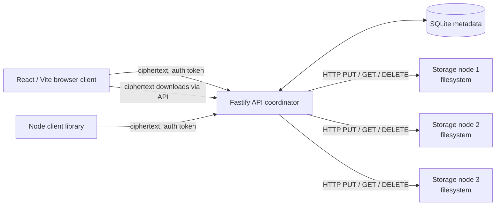
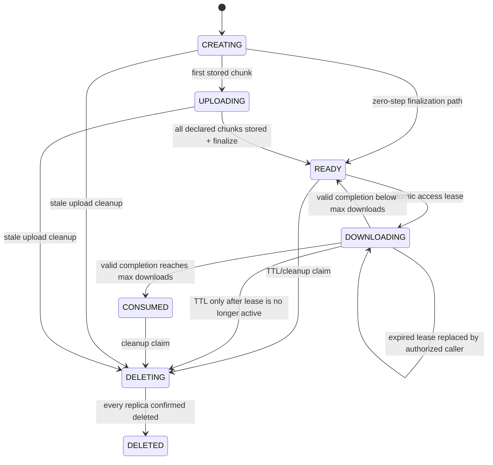

# VoidShare: Implemented Architecture Handoff

> **Purpose:** This is an architecture-review handoff for another LLM or engineer. It describes what is implemented in the `v1.0.0` codebase, including important gaps between reusable components and production wiring. Treat the source code as authoritative where this document and older planning documents differ.

## 1. System in one paragraph

VoidShare is an ephemeral file-sharing system with client-side encryption. A browser or Node-based client generates a random secret, derives a non-exportable AES-GCM encryption key and a separate authorization token, encrypts the file in chunks, and uploads ciphertext only. A Fastify API records metadata in SQLite and coordinates storage across filesystem-backed storage nodes. A recipient with the complete share URL obtains a short-lived download token using the derived authorization token, downloads ciphertext chunks, verifies their SHA-256 checksums, decrypts locally, and only then reports completion. The link secret stays in the URL fragment and is never deliberately sent to the API.

The repository is an npm workspace monorepo. The release tag is `v1.0.0`.

## 2. Topology and package ownership



| Package / location | Responsibility | Key implementation files |
| --- | --- | --- |
| `packages/shared` | Browser- and Node-compatible cryptography and shared domain types. | `src/crypto.ts`, `src/types.ts` |
| `packages/api` | API routes, metadata, placement, replication, failover reads, health state, cleanup, hardening. | `src/server.ts`, `src/main.ts` |
| `packages/storage-node` | Filesystem chunk store and storage-node HTTP server. | `src/storage.ts`, `src/server.ts` |
| `packages/web` | Vite/React single-page upload and download UI. | `src/index.tsx`, `src/transfer.ts` |
| `packages/cli` | Programmatic Node upload/download client; not a command-line executable wrapper. | `src/client.ts` |
| `scripts/run-storage-nodes.mjs` | Starts three local storage-node processes on ports 9001–9003. | `scripts/run-storage-nodes.mjs` |
| `docs` | Product, lifecycle, security, risk, API, and architecture documentation. | This document plus existing docs |

### Local runtime defaults

| Service | Default address / storage |
| --- | --- |
| API | `http://localhost:8080`; SQLite at `./data/api.db` |
| Web development server | `http://localhost:5173`; proxies `/api` to API port 8080 |
| Storage nodes | `http://localhost:9001`, `:9002`, `:9003`; data under `./data/node-1` through `node-3` |
| Replication factor in normal API upload path | 2 |
| Browser chunk size and upload/download concurrency | 4 MiB plaintext chunks; 3 concurrent workers |
| Maximum accepted transfer size | 200 MiB encrypted payload budget |
| Accepted TTLs | 10 minutes, 1 hour, 24 hours |

## 3. Trust boundaries and security model

### Assets and where they live

| Asset | Client | API / database | Storage node |
| --- | --- | --- | --- |
| Original file plaintext | Yes | No | No |
| 32-byte share secret | Yes, URL fragment | No | No |
| AES-GCM encryption key | Derived locally | No | No |
| Derived authorization token | Sent in `Authorization` or init JSON | Raw value is transient; SHA-256 hash stored | No |
| Upload session token | Returned once to sender | SHA-256 hash stored | No |
| Download token | Returned once to recipient | SHA-256 hash and expiry stored | No |
| Ciphertext chunks | Temporarily in browser / CLI memory | May be buffered during replicated upload | Yes |
| Transfer metadata | Client receives required subset | Yes | No |

### Cryptographic design

Implemented in [`packages/shared/src/crypto.ts`](../packages/shared/src/crypto.ts):

1. `generateSecret()` generates 32 random bytes using Web Crypto and encodes them as 64 hexadecimal characters.
2. The secret is imported as HKDF key material.
3. HKDF-SHA-256 with domain-separation labels derives:
   - `voidshare-enc` → non-exportable AES-256-GCM `encKey`.
   - `voidshare-auth` → 32-byte authorization token.
   - `voidshare-filename` → separate AES-256-GCM key for the encrypted filename.
4. Each file chunk gets a fresh random 96-bit IV. The stored payload is `IV || ciphertext || 128-bit GCM tag`.
5. Each AES-GCM operation includes AAD: UTF-8 `fileId`, then `chunkIndex` and `totalChunks` as unsigned 32-bit integers. This binds ciphertext to its transfer and position.
6. Clients SHA-256 hash the ciphertext payload; storage nodes verify the hash on write, and clients verify it again before decrypting.

The API receives the derived authorization token, not the encryption key or URL fragment. It stores only `sha256(authToken)` and compares hashes with `timingSafeEqual` after matching lengths. Upload-session and download tokens are independently random, returned only once, and stored only as hashes.

### Capability model

The share URL format is effectively:

```text
https://host/download/<fileId>#<64-hex-secret>
```

Browsers do not send fragment identifiers in HTTP requests. The download page reads the fragment locally, derives `authToken`, and sends that derived value as a Bearer token for access. The API knows that the caller has the capability but cannot derive the decryption key from it.

### Current logging and abuse controls

- Production API startup enables Pino through [`packages/api/src/main.ts`](../packages/api/src/main.ts).
- Redaction removes `Authorization`, body token fields, and response upload/download token fields. The paths are defined in [`packages/api/src/hardening/logging.ts`](../packages/api/src/hardening/logging.ts).
- Process-local route buckets apply to initialization, upload/status/finalize, access, and download/complete operations. Defaults are 20 initialization/access requests or 120 upload/download requests per minute per IP.
- Invalid IDs or capabilities generally return the same `404 { "error": "TRANSFER_NOT_FOUND" }`. A caller with a valid capability receives `410 TRANSFER_GONE` only when the transfer is genuinely consumed/expired/deleted.

## 4. Main request flows

### 4.1 Upload flow

```mermaid
sequenceDiagram
  participant C as Browser or CLI
  participant A as API
  participant D as SQLite
  participant S1 as Storage node A
  participant S2 as Storage node B

  C->>C: Generate secret; derive encKey and authToken
  C->>A: POST /api/transfers with derived authToken
  A->>D: Store hash(authToken), hash(upload token), metadata
  A-->>C: fileId + one-time upload token
  loop each encrypted chunk
    C->>C: AES-GCM encrypt with AAD; hash ciphertext
    C->>A: PUT chunk with upload token + checksum
    A->>D: Mark chunk PENDING
    par replicated writes
      A->>S1: PUT ciphertext chunk
      A->>S2: PUT ciphertext chunk
    end
    A->>D: Store confirmed replicas; mark chunk STORED
  end
  C->>A: POST finalize with upload token
  A->>D: READY only if every expected chunk is STORED
  A-->>C: READY
```

Detailed behavior:

- `POST /api/transfers` validates size, chunk count, chunk size, TTL, token syntax, and encrypted filename type. It creates a 128-bit random `fileId`, stores token hashes, and returns a distinct random `uploadToken`.
- The browser encrypts 4 MiB plaintext chunks and uploads at most three chunks concurrently. The CLI uploads sequentially.
- The API marks the chunk `PENDING`, uses the placement/replication service, then changes it to `STORED` only after the requested two replicas confirm writes and checksums.
- If the initial two placement targets fail, replication tries later nodes from the same ring order until it has two confirmations or runs out of eligible nodes.
- `GET /api/transfers/:fileId/status`, authorized by the upload token, returns stored and missing chunk indices. The browser UI does not currently use this endpoint to resume an interrupted upload, but the API contract supports it.
- `POST /finalize` transitions the transfer to `READY` only if stored-chunk count equals declared chunk count.

### 4.2 Download flow

```mermaid
sequenceDiagram
  participant R as Recipient browser or CLI
  participant A as API
  participant D as SQLite
  participant S as Replica set

  R->>R: Read fragment; derive encKey and authToken
  R->>A: POST access with authToken
  A->>D: Atomic READY -> DOWNLOADING lease acquisition
  A-->>R: Manifest + one-time 60s download token
  loop manifest chunks
    R->>A: GET chunk with download token
    A->>S: Read healthiest confirmed replica, fail over if needed
    A-->>R: ciphertext stream
    R->>R: SHA-256 verify; AES-GCM decrypt with AAD
  end
  R->>A: POST complete with download token
  A->>D: Atomically count completion and consume or return to READY
```

Detailed behavior:

- A valid access request atomically performs `READY → DOWNLOADING` with a 60-second lease and a new random download token. The SQLite `UPDATE` itself checks capability hash, expiry, download limit, and state; two simultaneous readers cannot both win.
- A lease expired by a disconnected recipient can be replaced by a later authorized access request. Replacing a lease invalidates the prior download token.
- Chunk reads require `DOWNLOADING`, an unexpired lease, and the hashed download token. They use `ReplicaReadService`, which orders replicas by health and tries another on network/HTTP failure.
- The API returns `NODE_UNAVAILABLE` only after exhausting confirmed replicas. Other chunk-read errors return `CHUNK_UNAVAILABLE`.
- The client checks ciphertext SHA-256 before AES-GCM decryption and calls `/complete` only after all chunks decrypt. Completion clears the lease/token and increments `download_count`. At the maximum count, the transfer becomes `CONSUMED`; otherwise it returns to `READY`.

## 5. API surface implemented in code

All transfer routes are in [`packages/api/src/routes/transfers.ts`](../packages/api/src/routes/transfers.ts). Auth tokens use `Authorization: Bearer <64-hex-token>` except initialization, where the derived auth token is in JSON.

| Method | Route | Authorization | Main behavior |
| --- | --- | --- | --- |
| `POST` | `/api/transfers` | Derived auth token in body | Initializes metadata; returns file ID and upload token. |
| `PUT` | `/api/transfers/:fileId/chunks/:index` | Upload token | Validates index/checksum; stores ciphertext with replication. |
| `POST` | `/api/transfers/:fileId/finalize` | Upload token | Marks fully stored transfer `READY`. |
| `GET` | `/api/transfers/:fileId/status` | Upload token | Returns stored and missing chunk indices for resumption. |
| `POST` | `/api/transfers/:fileId/access` | Derived auth token | Acquires download lease and returns manifest/token. |
| `GET` | `/api/transfers/:fileId/chunks/:index` | Download token | Streams ciphertext via failover reads. |
| `POST` | `/api/transfers/:fileId/complete` | Download token | Atomically records successful completion. |
| `POST` | `/api/nodes/heartbeat` | **None in current code** | Records node health/capacity data. |
| `GET` | `/api/nodes/health` | **None in current code** | Refreshes staleness state and returns nodes/transitions. |

Storage nodes expose:

| Method | Route | Behavior |
| --- | --- | --- |
| `PUT` | `/chunks/:chunkId` | Hashes stream, writes temp file, verifies checksum, atomically renames. |
| `GET` | `/chunks/:chunkId` | Streams stored ciphertext. |
| `HEAD` | `/chunks/:chunkId` | Reports existence. |
| `DELETE` | `/chunks/:chunkId` | Idempotently removes a chunk. |
| `GET` | `/chunks` | Lists non-temporary files for reconciliation. |
| `GET` | `/health` | Calculates used bytes and returns node status/capacity. |

## 6. Metadata model and state machines

The SQLite schema is [`packages/api/src/db/schema.sql`](../packages/api/src/db/schema.sql). `better-sqlite3` uses transactions for state-changing metadata operations.

### Core tables

| Table | Purpose | Important fields |
| --- | --- | --- |
| `transfers` | Transfer lifecycle and capabilities. | `file_id`, token hashes, size/chunk declarations, status, TTL, lease, download count. |
| `chunks` | One row per logical encrypted chunk. | `file_id`, `chunk_index`, ciphertext size, SHA-256 checksum, status. |
| `storage_nodes` | Known node endpoint and observed health/capacity. | endpoint, status, capacity, used bytes, heartbeat. |
| `chunk_replicas` | Confirmed physical copies and deletion state. | `chunk_id`, `node_id`, `ACTIVE`, `DELETED`, or `ORPHANED_PENDING_DELETE`. |
| `chunk_placements` | Consistent-hash placement order, independent of confirmed replicas. | `chunk_id`, `node_id`, rank. |

### Transfer lifecycle



The code also recognizes `EXPIRED` and `FAILED` as cleanup/recovery states. Actual expiry is enforced during access checks before a background sweeper changes the row state.

### Cleanup behavior

`ExpirationSweeper` and `StorageReconciler` are implemented in [`packages/api/src/cleanup/cleanup.ts`](../packages/api/src/cleanup/cleanup.ts):

- The sweeper claims TTL-expired, consumed, stale in-progress uploads (30 minutes), failed, or already-deleting transfers.
- It explicitly does **not** claim a `DOWNLOADING` transfer with a still-active lease.
- Replica delete calls use `Promise.allSettled`; a failed/unreachable delete becomes `ORPHANED_PENDING_DELETE` rather than being falsely recorded as deleted.
- A transfer reaches `DELETED` only when all its replica records are `DELETED`.
- The reconciler lists node files, preserves active metadata-backed chunks, deletes unknown files, and retries orphan-pending deletes on reachable nodes.

## 7. Distributed storage behavior

### Placement

[`ConsistentHashRing`](../packages/api/src/placement/ring.ts) hashes `nodeId#virtualNodeIndex` with SHA-256 and creates 128 virtual points per healthy node. A chunk ID is hashed to a position, then the ring is traversed to choose distinct nodes. This reduces remapping when a node set changes relative to modulo hashing.

`PlacementService` filters candidates to `HEALTHY` nodes and rejects a node if known used bytes plus proposed chunk size exceed declared capacity. A capacity value of zero means unbounded/unknown capacity.

### Replication

`ReplicationService` concurrently writes the initial two selected targets. It records only confirmed replicas in `chunk_replicas`. If an initial write fails, it tries successive nodes from ring order until it reaches the replication factor or fails the upload.

### Read failover

`ReplicaReadService` orders confirmed active replicas as `HEALTHY`, `RECOVERING`, `UNHEALTHY`, then `UNAVAILABLE`. It requests each in order and falls back after errors. It deliberately does not disclose individual node failures to the client.

### Recovery

`RecoveryService` finds stored chunks with fewer than two active replicas, excludes deleting/expired/deleted transfers, reads and verifies a healthy source, selects a healthy non-replica target, writes it, verifies the result, then adds the target as confirmed. It does not persist a replica record on a failed or corrupt copy attempt.

### Health model

`HealthMonitor` marks nodes:

- `HEALTHY` while heartbeat age is below 15 seconds.
- `UNHEALTHY` at 15 seconds or more.
- `UNAVAILABLE` at 60 seconds or more.

It supports injected clocks for deterministic tests. Heartbeat data includes endpoint URL, total/used capacity, and active operations.

## 8. Web UI and CLI behavior

### Web application

The React application supports two paths:

- `/` is the polished drag-and-drop upload page. It enforces the 200 MiB UI limit, uses a 24-hour TTL and one allowed download, encrypts locally, uploads with three concurrent chunk workers, and presents a share link.
- `/download/:fileId#secret` is the download page. It reads the fragment, derives keys, downloads/decrypts chunks with three concurrent workers, creates a `Blob`, and triggers a browser save.

The Vite proxy only applies during development; a production deployment must configure API routing/reverse proxying separately.

### CLI library

The CLI package exports `uploadBytes` and `downloadBytes`. It provides encrypted round-trip logic and tests but does **not** currently expose a `bin` command, argument parser, progress UI, resume logic, or file-system wrapper for a terminal user.

## 9. What is implemented versus what is only a callable capability

This distinction is critical for architectural change requests.

| Capability | Implemented as a class/service | Wired into `main.ts` and automatically scheduled? |
| --- | --- | --- |
| API routing, storage RPC, replication, failover reads | Yes | Yes |
| SQLite metadata | Yes | Yes |
| Node registration at startup | Yes | Yes, nodes are initially inserted as `HEALTHY` |
| Browser upload/download | Yes | Yes |
| Manual heartbeat intake and health query | Yes | Routes are registered, but no node emits heartbeats automatically |
| Under-replication recovery | Yes | No periodic worker or trigger is wired |
| Expiration sweeper | Yes | No periodic worker is wired |
| Orphan reconciliation | Yes | No periodic worker or reconnect trigger is wired |
| Cleanup after `CONSUMED` | State transition exists | Requires caller to run sweeper to reclaim bytes |
| CLI command-line executable | No | No |
| Docker Compose deployment | No; optional plan item | No |

## 10. Current architectural constraints and review targets

These are not hidden defects; they are the most useful inputs for an LLM asked to improve the architecture.

1. **Background work is not orchestrated.** Cleanup, reconciliation, recovery, and heartbeat emission are tested services without a scheduler, leader election, jobs table, retry backoff, or observability. Add a worker process or durable job system before treating expiry and healing as automatic production guarantees.
2. **SQLite is single-host metadata.** `better-sqlite3` provides local transactions, including the lease CAS, but it is not a multi-region or multi-writer coordinator. Multiple API processes pointing at shared SQLite need deliberate locking/deployment design; a distributed metadata store would need new transactional semantics.
3. **Rate limiting is in memory.** Limits reset on process restart and multiply across API instances. Use Redis or another shared limiter before horizontal scaling.
4. **Storage-node control plane is unauthenticated.** Storage chunk, listing, delete, health, and API heartbeat endpoints have no mTLS/service credential enforcement in current code. The older docs describe internal tokens, but the code does not implement them.
5. **Transport security is deployment-dependent.** The local implementation uses HTTP. Production must terminate TLS and secure API-to-storage communication, ideally with mTLS for the internal plane.
6. **Replicated upload buffers a whole chunk in API memory.** The replication route collects each request body into a `Buffer` to fan out to two nodes. With 10 MiB allowed encrypted chunks and concurrent requests, memory pressure must be modeled. A streaming tee with backpressure or object-store multipart strategy would be a likely improvement.
7. **The web client reconstructs the full download in memory.** It downloads/decrypts all chunks before building a `Blob`. The current 200 MiB cap limits exposure, but streaming-to-file APIs or incremental writing would scale better.
8. **Resumability is API-ready but UI-incomplete.** The status endpoint returns missing chunks, but the browser/CLI client always begins a fresh initialization rather than persisting upload session context and resuming.
9. **Filename encryption uses a fixed zero IV.** The current filename key is uniquely derived from a normally unique share secret and only one filename is encrypted per transfer, so the design relies on one encryption per key. A safer, more general envelope would generate and prefix a random filename IV just like chunks.
10. **Node capacity and health are advisory.** Storage-node health endpoint calculates usage locally, but nodes do not automatically report to the API; startup registers all configured nodes as healthy. Placement can therefore use stale capacity/health information.
11. **No external identity or tenant model exists.** The product intentionally uses bearer capabilities, not accounts. If teams, auditing, revocation by owner, billing, or abuse attribution are needed, add them without weakening the secret-capability model.
12. **No at-rest metadata encryption, backup, or key rotation plan exists.** The database contains non-secret metadata and hashed tokens, but production backup/retention requirements still need a defined policy.
13. **No runtime metrics/tracing or alerting exists.** Logs are redacted, but there are no metrics for replication success, orphan backlog, lease contention, node capacity, or cleanup latency.

## 11. Suggested architecture-review prompt for another LLM

Copy the following, together with this document and relevant source files:

```text
You are reviewing the implemented VoidShare v1.0.0 architecture described in IMPLEMENTED_ARCHITECTURE.md. Do not assume planned features exist when the document marks them as callable but unwired.

Propose a production-ready v2 architecture that preserves the core guarantees:
- client-side AES-256-GCM encryption;
- the API never receives the decryption key or URL fragment;
- capability-based access with existence privacy;
- resumable encrypted chunk uploads;
- replication factor 2, replica read failover, and safe cleanup;
- atomic single-download behavior.

Focus on these questions:
1. What should become a durable background job, how should it be scheduled, retried, observed, and made safe under multiple workers?
2. What metadata store and transaction model should replace or constrain SQLite for horizontal scaling?
3. How should API-to-storage authentication, authorization, TLS/mTLS, and node enrollment work?
4. How should rate limiting, node heartbeats, capacity, recovery, cleanup, and reconciliation work across multiple instances and regions?
5. How can upload fan-out and download assembly be streamed to avoid buffering entire chunks/files in memory?
6. What API, schema, state-machine, and migration changes are required? Call out compatibility concerns.
7. Identify security weaknesses and rank improvements by risk, effort, and impact.

Return: (a) an architecture diagram, (b) a phased migration plan, (c) schema/API deltas, (d) failure-mode analysis, (e) observability plan, and (f) a prioritized backlog. Be explicit about tradeoffs and do not recommend sending the client encryption key to the server.
```

## 12. Verification baseline

At the `v1.0.0` tag the repository has:

- 61 passing Vitest tests across shared crypto, storage, API routes, placement, replication, failover, health, recovery, cleanup, CLI, and hardening.
- Successful TypeScript/Vite builds for all workspaces.
- `npm audit --audit-level=high` reporting zero vulnerabilities at the release verification time.
- A clean-clone setup documented in [`README.md`](../README.md).

