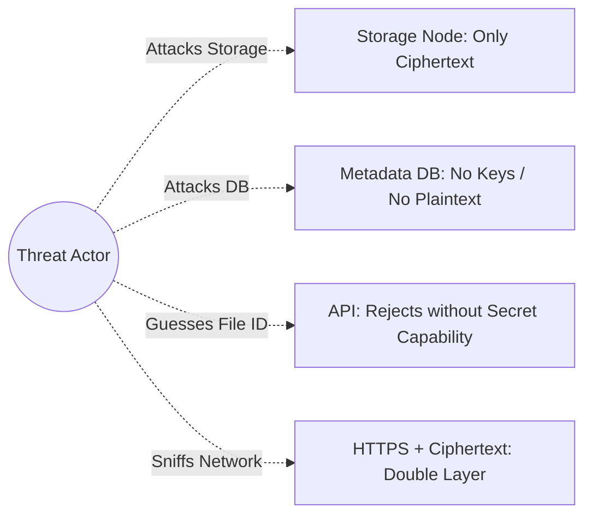

# Security Model & Threat Assessment - VoidShare

## 1. Security Philosophy & Honest Claims

VoidShare is built on a **Zero-Knowledge Architecture** regarding file contents. We uphold rigorous technical honesty:

> **The True Claim**: The service infrastructure (API controllers, metadata database, storage nodes, background workers, and logs) strictly receives, stores, and routes **encrypted ciphertext**. Plaintext data and client-side decryption keys are mathematically and architecturally inaccessible to server administrators.

### What E2EE Guarantees
- The backend and storage nodes cannot decrypt stored chunks or view plaintext file contents.
- A database dump or compromise reveals only operational metadata (chunk indices, node locations, TTL, download counts), not decryption keys or plaintext.
- A compromise of an individual storage node exposes only isolated, encrypted chunks without keys.

### What E2EE Does NOT Guarantee
- It does not conceal transfer existence or metadata (file size, chunk count, timestamp, IP network connection) from network observers or the host server.
- It does not protect against a compromised client browser (e.g. malicious browser extensions or compromised client OS).
- It does not prevent brute-forcing weak, user-chosen passwords (mitigated by generating high-entropy cryptographic secrets by default).

---

## 2. Threat Model & Mitigation Matrix



| Threat Category | Potential Impact | VoidShare Architectural Mitigation |
| :--- | :--- | :--- |
| **Curious Storage Administrator** | Admin inspects storage disks to read user files. | Storage nodes store exclusively AES-256-GCM encrypted chunks. Plaintext is never accessible. |
| **Metadata Database Compromise** | Attacker gains full read access to database records. | Database schema omits decryption keys. Only contains opaque identifiers, chunk mappings, and expiration times. |
| **Storage Node Breach** | Attacker compromises one or more storage nodes. | Compromised nodes contain fragmented ciphertext chunks. Without the client secret and complete chunk set, data cannot be reconstructed. |
| **File ID Enumeration / Guessing** | Attacker iterates IDs (e.g. `file/1`, `file/2`) to discover files. | IDs are generated via CSPRNG (128-bit entropy). API does not reveal file existence without the corresponding secret capability. |
| **Secret / Key Leakage via Logs** | Developers/admins inspect logs containing secrets. | Decryption secrets reside exclusively in client URL hash fragments (`#secret`) which browsers never send to servers. Loggers strictly sanitize query/payload parameters. |
| **Unauthorized Retrieval & Replay** | Unauthorized user attempts to download transfer after consumption. | Capability verification requires valid secret hash. Transfers configured with `DELETE_AFTER_DOWNLOAD` transition atomically to `CONSUMED` upon first complete download. |
| **Chunk Tampering / Bit Rot** | Malicious node or corrupted disk alters chunk data. | AES-GCM 128-bit authentication tag + SHA-256 chunk checksum validated by client before file assembly. Corrupted chunks are immediately rejected. |
| **Expiration Race Exploitation** | User attempts to download while background worker deletes. | Atomic state locking (`READY` → `DOWNLOADING` / `DELETING`) ensures deterministic execution without data corruption or partial reads. |

---

## 3. Capability-Based Access Control

Traditional authentication relies on user accounts and sessions:
$$\text{User} \xrightarrow{\text{Credentials}} \text{Session} \xrightarrow{\text{ACL}} \text{File}$$

VoidShare implements **Capability-Based Security**:
$$\text{Possession of Capability } (\text{File ID} + \text{Secret}) \xrightarrow{\text{Cryptographic Proof}} \text{Access Transfer}$$

- **File ID**: Acts as the locator for the transfer entity.
- **Secret Key**: Acts as the cryptographic capability.
- **Access Authorization**: The client derives an authorization proof (e.g., `HMAC-SHA256(secretKey, fileId)`) to authenticate with the API before chunk download URLs or streams are authorized.

---

## 4. Cryptographic Implementation Details

1. **Client-Side Key Generation**:
   - Keys are generated locally using `window.crypto.subtle.generateKey({ name: "AES-GCM", length: 256 }, true, ["encrypt", "decrypt"])`.
2. **IV Randomization**:
   - A unique 96-bit (12-byte) initialization vector is generated for each chunk via `window.crypto.getRandomValues(new Uint8Array(12))`.
   - IVs are never reused across chunks or files.
3. **Payload Structure**:
   ```
   [ 12-Byte IV ] + [ Encrypted Ciphertext Chunk ] + [ 16-Byte AES-GCM Auth Tag ]
   ```

---

## 5. Logging & Privacy Guardrails

To prevent accidental privacy leaks in production logs, the following rules are mandatory:

```
[STRICTLY PROHIBITED IN LOGS]
✖ Client-side decryption keys
✖ Secret passwords or URL hash fragments
✖ Plaintext file contents / buffers
✖ Plaintext file names (unless explicitly opt-in by user)

[ALLOWED OPERATIONAL METRICS]
✔ Transfer ID (UUID/Opaque)
✔ Chunk ID & Index (e.g., chunk_003)
✔ Node ID (e.g., storage_node_02)
✔ Operation Type (UPLOAD, DOWNLOAD, PURGE, HEARTBEAT)
✔ Chunk Size (bytes) & Network Latency (ms)
✔ Categorized Error Codes (e.g., ERR_NODE_TIMEOUT)
```

## 6. Release Hardening Controls

- Fastify uses Pino redaction for authorization headers and token-shaped request/response fields. Secret values are never intentionally logged.
- Transfer initialization, upload/status/finalize, access, download, and completion routes use separate process-local rate-limit buckets. A horizontally scaled deployment must replace these counters with a shared store.
- The release gate runs `npm audit`, the full Vitest suite, all workspace builds, and `git diff --check` against the committed lockfile.
- The clean-clone demo starts the three storage nodes, the API, and the Vite client; browser verification confirms the share secret remains in the fragment and never enters a request URL.
